# SHIELD_AI — 3D Asset Catalog

Low-poly assets for the project's educational Unity simulation: the original scenario assets, a defense scenario kit of threats, interceptors, launchers, radars, and a command center, and a city environment kit of buildings, tiles, and street props. Each asset has an editable Blender source, an FBX export, and a PNG preview.

The visual style uses simple gray materials with blue accents; threat models add red so they read differently from the blue defense assets. All models are fictional, nonfunctional exterior visuals without flight behavior. Every asset except Radar_01 has a specification JSON file.

| Group | Assets | Triangles |
|---|---:|---:|
| [Original scenario assets](#inventory) | 4 | 3,504 |
| [Defense scenario kit](#defense-scenario-kit) | 11 | 8,822 |
| [Buildings and ground](#buildings-and-ground) | 13 | 16,624 |
| [Road and park tiles](#road-and-park-tiles) | 5 | 3,480 |
| [Street props](#street-props) | 6 | 1,102 |
| [Terrain](#terrain) | 1 | 4,800 |
| **Total** | **40** | **38,332** |

An assembled, rendered city made from these assets is described under [City scene](#city-scene).

> **Blender version:** the four original assets were saved with Blender 5.0, which older Blender versions cannot open. Everything else was saved with Blender 3.0.1 and opens in 3.0 or newer. The FBX files work regardless.

## Inventory

Dimensions are reported **width × length × height**, in metres. Counts and measurements below come from the asset-generation reports; the source files were not independently measured for this README.

| Preview | Asset | Dimensions (m) | Triangles | Animated parts | Files |
|---|---|---|---:|---|---|
| 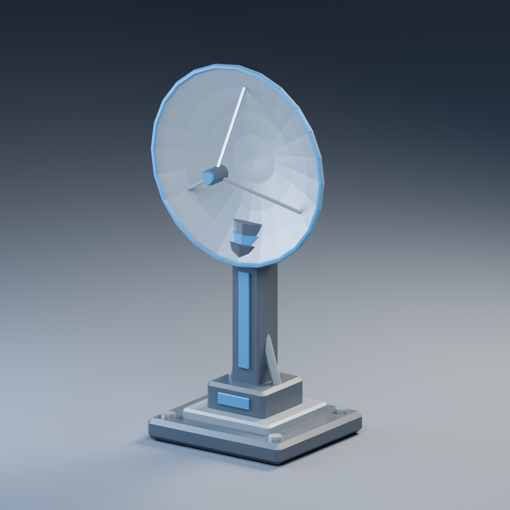 | [Radar_01](#radar_01) | Height: 3.60; width/length not reported | 1,856 | Rotating mount and dish | [Blend](Radar_01/Radar_01.blend) · [FBX](Radar_01/Radar_01.fbx) · [PNG](Radar_01/Radar_01_preview.png) |
| 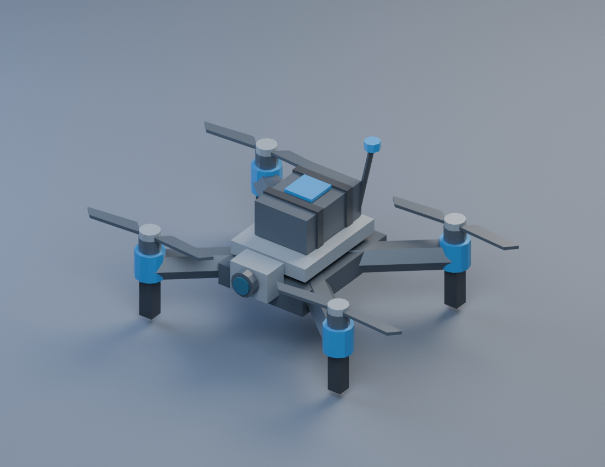 | [FPV_Quadcopter_01](#fpv_quadcopter_01) | 0.634 × 0.372 × 0.290 | 972 | Four propellers | [Blend](FPV_Quadcopter_01/FPV_Quadcopter_01.blend) · [FBX](FPV_Quadcopter_01/FPV_Quadcopter_01.fbx) · [PNG](FPV_Quadcopter_01/FPV_Quadcopter_01_preview.png) · [Specs](FPV_Quadcopter_01/FPV_Quadcopter_01_specs.json) |
|  | [Shahed_Style_Drone_01](#shahed_style_drone_01) | 2.400 × 1.800 × 0.345 | 256 | Rear propeller | [Blend](Shahed_Style_Drone_01/Shahed_Style_Drone_01.blend) · [FBX](Shahed_Style_Drone_01/Shahed_Style_Drone_01.fbx) · [PNG](Shahed_Style_Drone_01/Shahed_Style_Drone_01_preview.png) · [Specs](Shahed_Style_Drone_01/Shahed_Style_Drone_01_specs.json) |
| 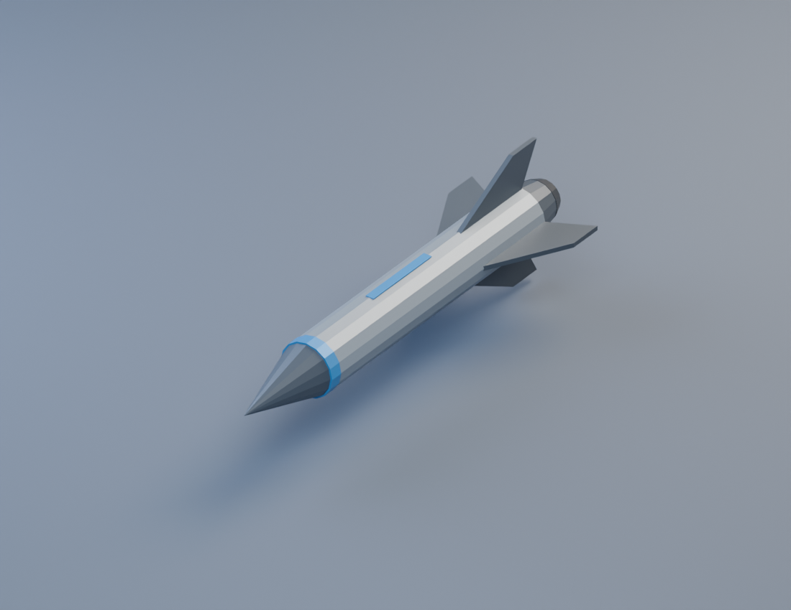 | [Generic_Missile_01](#generic_missile_01) | 0.700 × 2.290 × 0.700 | 420 | No dedicated animated part reported | [Blend](Generic_Missile_01/Generic_Missile_01.blend) · [FBX](Generic_Missile_01/Generic_Missile_01.fbx) · [PNG](Generic_Missile_01/Generic_Missile_01_preview.png) · [Specs](Generic_Missile_01/Generic_Missile_01_specs.json) |
| — | **Total** | — | **3,504** | — | — |

## Radar_01

Fictional radar with a ground-level root and separate base, rotating mount, and dish. The reported height is 3.60 metres.

- [Blender source](Radar_01/Radar_01.blend)
- [Unity FBX export](Radar_01/Radar_01.fbx)
- [Preview PNG](Radar_01/Radar_01_preview.png)

No radar specification JSON appears in the supplied directory listing.

**Animation:** rotate the mount about its local Unity Y axis after checking the imported hierarchy. The dish should follow the mount while the base stays fixed.

**Visual review:** the preview appears to show mounting pieces near the lower front of the dish. Inspect this area in Blender before deciding whether to revise it.

## FPV_Quadcopter_01

Compact, stylized quadcopter with four arms, motors, separate propellers, a front camera, and a battery block.

- [Blender source](FPV_Quadcopter_01/FPV_Quadcopter_01.blend)
- [Unity FBX export](FPV_Quadcopter_01/FPV_Quadcopter_01.fbx)
- [Preview PNG](FPV_Quadcopter_01/FPV_Quadcopter_01_preview.png)
- [Specifications JSON](FPV_Quadcopter_01/FPV_Quadcopter_01_specs.json)

**Animation:** each propeller has a reported motor-centered pivot. Inspect its imported local axes before choosing the spin axis.

**Review (FBX inspection):** propeller pivots sit at the motor centres as reported, and each blade sweeps a 0.127 m radius without hitting the frame, battery, or camera. The antenna clears the rear-right propeller by only about 4 mm, so the spinning blade may appear to clip it. The FrontCamera faces Blender −Y, which every newer asset also uses as its front. The specification JSON stores absolute Windows paths (`E:\GitHub repo\...`) rather than relative ones.

## Shahed_Style_Drone_01

Fictional delta-wing exterior inspired by a recognizable silhouette, with a central body, wingtip fins, and a separate rear propeller. The dimensions are visual design choices, not validated real-world specifications.

- [Blender source](Shahed_Style_Drone_01/Shahed_Style_Drone_01.blend)
- [Unity FBX export](Shahed_Style_Drone_01/Shahed_Style_Drone_01.fbx)
- [Preview PNG](Shahed_Style_Drone_01/Shahed_Style_Drone_01_preview.png)
- [Specifications JSON](Shahed_Style_Drone_01/Shahed_Style_Drone_01_specs.json)

**Animation:** rotate only the rear propeller for the visual spin effect. Inspect its local axis after import.

## Generic_Missile_01

Fictional cylindrical exterior with a pointed nose, tail fins, and a rear nozzle. It contains no internal weapon components or guidance system.

- [Blender source](Generic_Missile_01/Generic_Missile_01.blend)
- [Unity FBX export](Generic_Missile_01/Generic_Missile_01.fbx)
- [Preview PNG](Generic_Missile_01/Generic_Missile_01_preview.png)
- [Specifications JSON](Generic_Missile_01/Generic_Missile_01_specs.json)

Movement and visual trails are separate Unity features; they are not included in this model.

## Defense scenario kit

Fictional, generic models for the roadmap's three threat types and three defense layers. They are stylized silhouettes chosen to make each layer easy to tell apart, not models of real systems. Generic_Missile_01 above serves as the cruise threat.

Dimensions and triangle counts below were measured from the generated meshes. Every FBX in this kit and the city kit was re-imported into Blender and matched its specs for triangle count, hierarchy, dimensions, and pivots. None has been checked in Unity yet.

### Threats and interceptors

Flying objects have their origin at the body centre with the nose toward Blender −Y.

| Preview | Asset | Dimensions (m) | Triangles | Description | Files |
|---|---|---|---:|---|---|
| 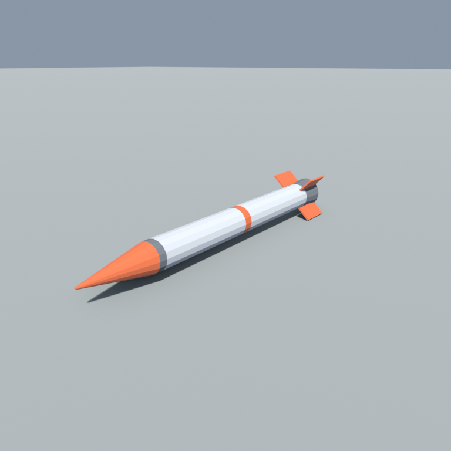 | Threat_Ballistic_01 | 1.48 × 11.00 × 1.48 | 468 | Long single body with a red nose, red band, and tail fins | [Blend](Threat_Ballistic_01/Threat_Ballistic_01.blend) · [FBX](Threat_Ballistic_01/Threat_Ballistic_01.fbx) · [PNG](Threat_Ballistic_01/Threat_Ballistic_01_preview.png) · [Specs](Threat_Ballistic_01/Threat_Ballistic_01_specs.json) |
| 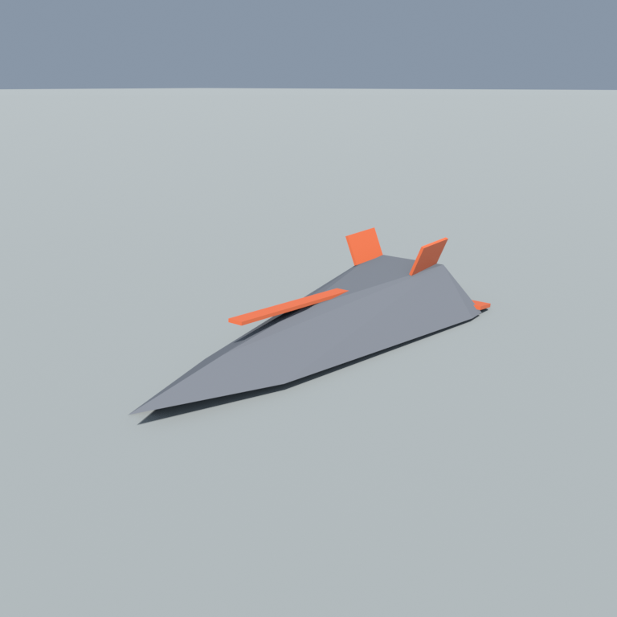 | Threat_Hypersonic_01 | 2.30 × 5.30 × 1.00 | 82 | Flat faceted wedge glider with red stripe, flaps, and canted fins | [Blend](Threat_Hypersonic_01/Threat_Hypersonic_01.blend) · [FBX](Threat_Hypersonic_01/Threat_Hypersonic_01.fbx) · [PNG](Threat_Hypersonic_01/Threat_Hypersonic_01_preview.png) · [Specs](Threat_Hypersonic_01/Threat_Hypersonic_01_specs.json) |
| 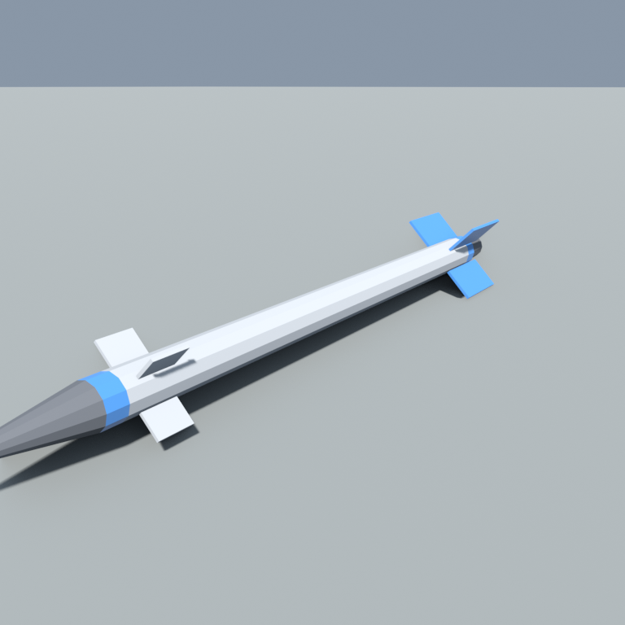 | Interceptor_ShortRange_01 | 0.36 × 3.00 × 0.36 | 316 | Slim interceptor with front canards and blue tail fins | [Blend](Interceptor_ShortRange_01/Interceptor_ShortRange_01.blend) · [FBX](Interceptor_ShortRange_01/Interceptor_ShortRange_01.fbx) · [PNG](Interceptor_ShortRange_01/Interceptor_ShortRange_01_preview.png) · [Specs](Interceptor_ShortRange_01/Interceptor_ShortRange_01_specs.json) |
| 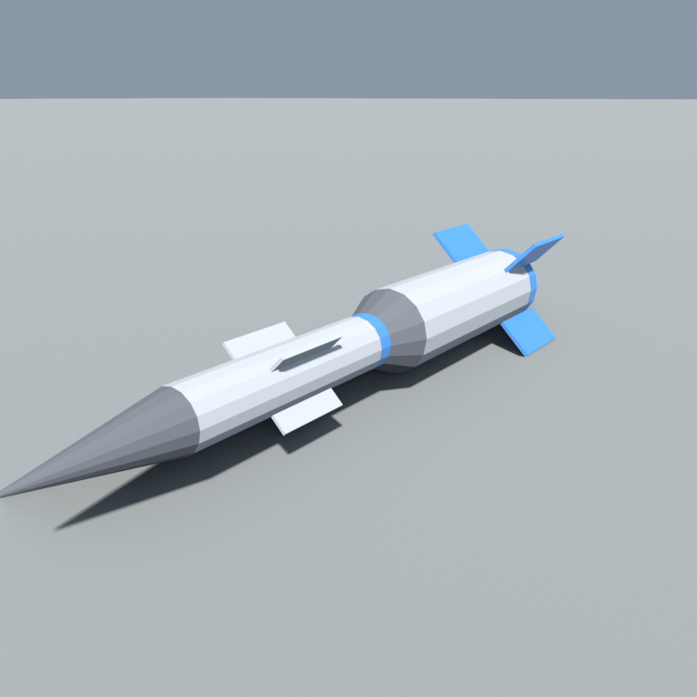 | Interceptor_MidRange_01 | 0.88 × 4.60 × 0.88 | 516 | Two-stage interceptor with mid-body fins and a wider finned booster | [Blend](Interceptor_MidRange_01/Interceptor_MidRange_01.blend) · [FBX](Interceptor_MidRange_01/Interceptor_MidRange_01.fbx) · [PNG](Interceptor_MidRange_01/Interceptor_MidRange_01_preview.png) · [Specs](Interceptor_MidRange_01/Interceptor_MidRange_01_specs.json) |
| 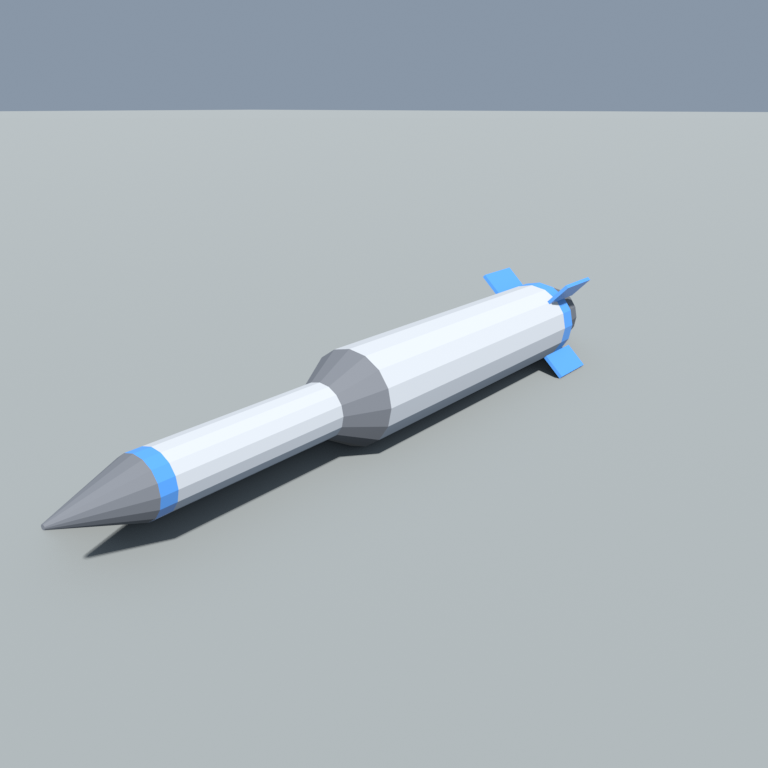 | Interceptor_LongRange_01 | 1.09 × 7.00 × 1.09 | 468 | Large two-stage interceptor with a slim upper stage and broad booster | [Blend](Interceptor_LongRange_01/Interceptor_LongRange_01.blend) · [FBX](Interceptor_LongRange_01/Interceptor_LongRange_01.fbx) · [PNG](Interceptor_LongRange_01/Interceptor_LongRange_01_preview.png) · [Specs](Interceptor_LongRange_01/Interceptor_LongRange_01_specs.json) |

### Launchers, radars, and command center

Ground assets have their origin on the ground and their front toward Blender −Y. Each moving part is a separate pivot object; its pivot and rest rotation are listed in the asset's specs JSON. The previews show launchers elevated; set the pivot's X rotation to 0 to stow them.

| Preview | Asset | Dimensions (m) | Triangles | Moving part | Files |
|---|---|---|---:|---|---|
| 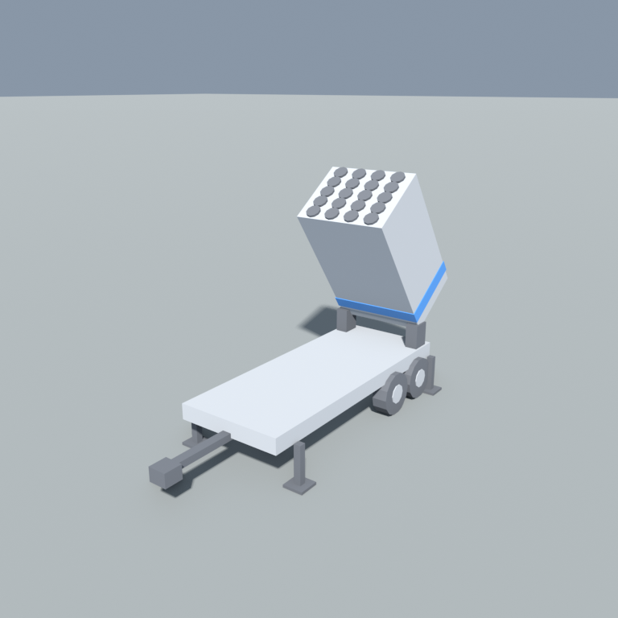 | Launcher_ShortRange_01 | 3.15 × 8.74 × 5.38 | 1,252 | `_Pod`: 20-tube pod on a towed trailer, elevated 55° about local X | [Blend](Launcher_ShortRange_01/Launcher_ShortRange_01.blend) · [FBX](Launcher_ShortRange_01/Launcher_ShortRange_01.fbx) · [PNG](Launcher_ShortRange_01/Launcher_ShortRange_01_preview.png) · [Specs](Launcher_ShortRange_01/Launcher_ShortRange_01_specs.json) |
| 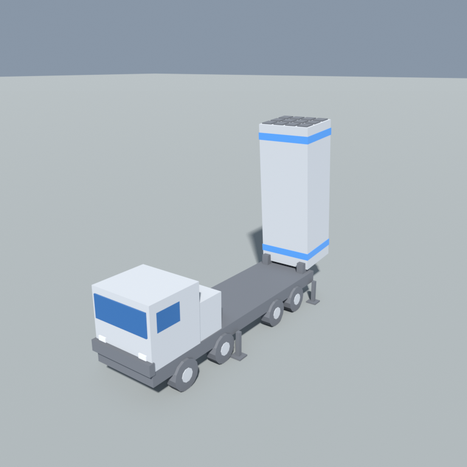 | Launcher_MidRange_01 | 3.45 × 11.75 × 7.84 | 1,100 | `_Rack`: 12-cell rack on an eight-wheel truck, raised 85° | [Blend](Launcher_MidRange_01/Launcher_MidRange_01.blend) · [FBX](Launcher_MidRange_01/Launcher_MidRange_01.fbx) · [PNG](Launcher_MidRange_01/Launcher_MidRange_01_preview.png) · [Specs](Launcher_MidRange_01/Launcher_MidRange_01_specs.json) |
| 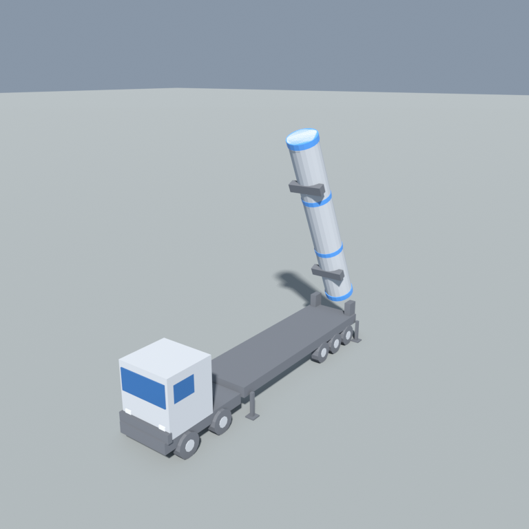 | Launcher_LongRange_01 | 3.65 × 15.79 × 11.74 | 1,500 | `_Canister`: single large canister on a tractor-trailer, raised 65° | [Blend](Launcher_LongRange_01/Launcher_LongRange_01.blend) · [FBX](Launcher_LongRange_01/Launcher_LongRange_01.fbx) · [PNG](Launcher_LongRange_01/Launcher_LongRange_01_preview.png) · [Specs](Launcher_LongRange_01/Launcher_LongRange_01_specs.json) |
| 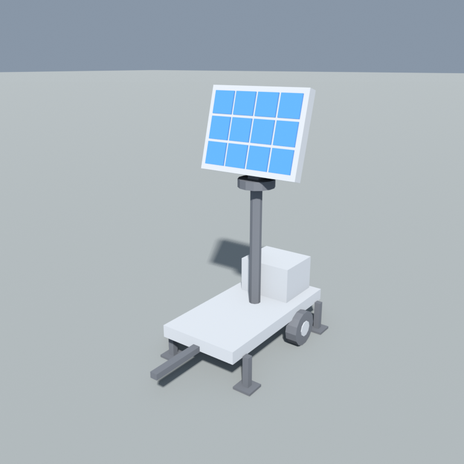 | Radar_Panel_01 | 2.65 × 5.35 × 6.35 | 564 | `_Head`: tilted panel on a mast; rotate about local Z | [Blend](Radar_Panel_01/Radar_Panel_01.blend) · [FBX](Radar_Panel_01/Radar_Panel_01.fbx) · [PNG](Radar_Panel_01/Radar_Panel_01_preview.png) · [Specs](Radar_Panel_01/Radar_Panel_01_specs.json) |
| 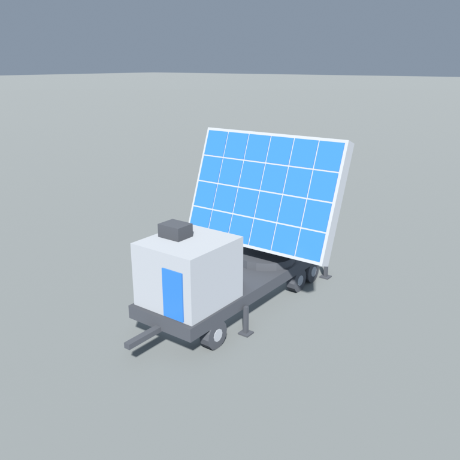 | Radar_Array_01 | 7.00 × 11.52 × 7.10 | 1,084 | `_Array`: large 6 × 4 tiled array on a turntable; rotate about local Z | [Blend](Radar_Array_01/Radar_Array_01.blend) · [FBX](Radar_Array_01/Radar_Array_01.fbx) · [PNG](Radar_Array_01/Radar_Array_01_preview.png) · [Specs](Radar_Array_01/Radar_Array_01_specs.json) |
| 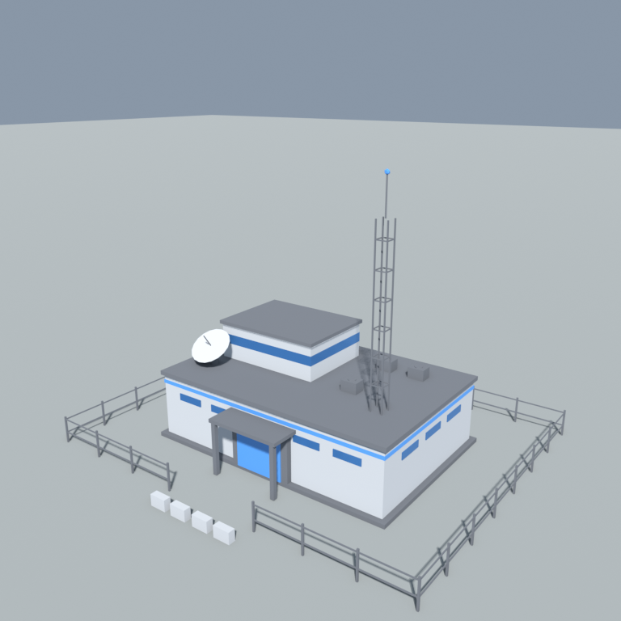 | Command_Center_01 | 28.12 × 23.81 × 19.88 | 1,472 | None. Low hardened building with blast door, roof operations room, lattice mast, dish, fenced compound, and gate barriers | [Blend](Command_Center_01/Command_Center_01.blend) · [FBX](Command_Center_01/Command_Center_01.fbx) · [PNG](Command_Center_01/Command_Center_01_preview.png) · [Specs](Command_Center_01/Command_Center_01_specs.json) |

Suggested layer pairing: Radar_Panel_01 + Launcher_ShortRange_01 + Interceptor_ShortRange_01; Radar_01 + Launcher_MidRange_01 + Interceptor_MidRange_01; Radar_Array_01 + Launcher_LongRange_01 + Interceptor_LongRange_01.

## City environment kit

Buildings, tiles, and props for the defended city scene. Dimensions and triangle counts below were measured from the generated meshes in Blender. The FBXs passed the Blender re-import check described above but have **not yet been checked in Unity**.

### Buildings and ground

The `_02` buildings are detailed revisions of the `_01` blockouts. Prefer `_02` for the scene; keep `_01` as lightweight stand-ins for distant or repeated buildings. Each `_Damaged` variant shares its intact building's footprint and origin, so it can be swapped in at the same transform when the city takes a hit. Its listed size is larger only because of the rubble. The `Background` buildings are cheap skyline fillers for the city edge.

| Preview | Asset | Dimensions (m) | Triangles | Description | Files |
|---|---|---|---:|---|---|
| 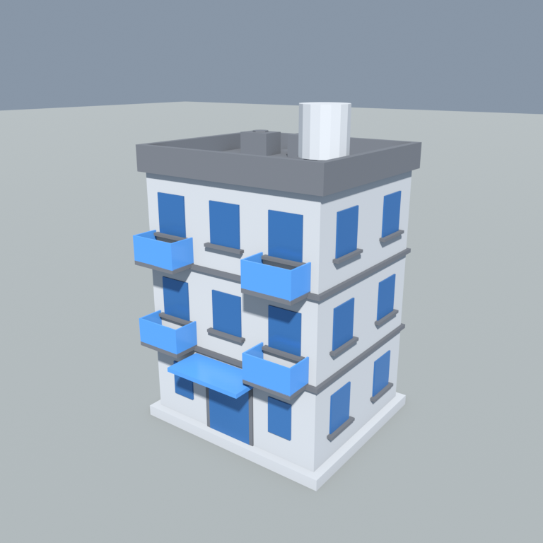 | Building_Small_02 | 7.60 × 7.70 × 11.70 | 1,176 | Three-storey residential building with window sills, floor ledges, front balconies, entrance canopy, rooftop water tank and AC units | [Blend](Building_Small_02/Building_Small_02.blend) · [FBX](Building_Small_02/Building_Small_02.fbx) · [PNG](Building_Small_02/Building_Small_02_preview.png) · [Specs](Building_Small_02/Building_Small_02_specs.json) |
| 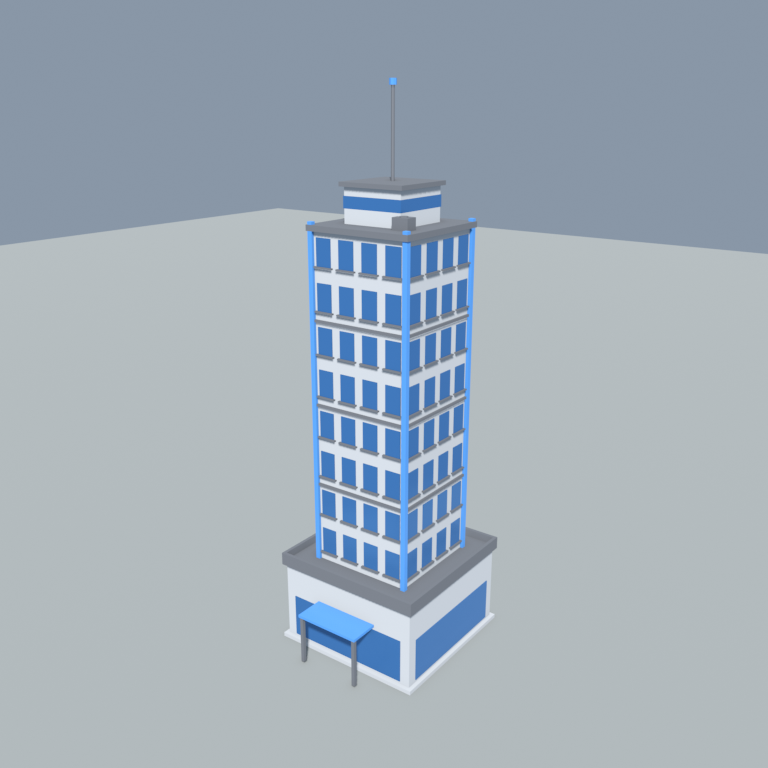 | Building_Tall_02 | 11.60 × 13.50 × 39.85 | 3,536 | Office tower with a glass-fronted podium, entrance canopy, eight window floors, blue corner fins, glazed crown, and antenna | [Blend](Building_Tall_02/Building_Tall_02.blend) · [FBX](Building_Tall_02/Building_Tall_02.fbx) · [PNG](Building_Tall_02/Building_Tall_02_preview.png) · [Specs](Building_Tall_02/Building_Tall_02_specs.json) |
| 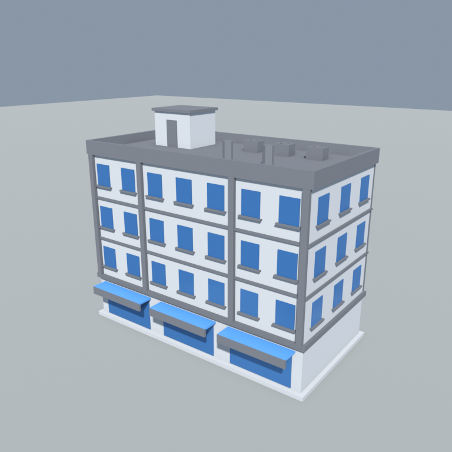 | Building_Block_02 | 18.60 × 11.45 × 16.20 | 2,124 | Wide four-storey block with ground-floor shopfronts and blue awnings, pilasters, rooftop stair housing, AC units, and vents | [Blend](Building_Block_02/Building_Block_02.blend) · [FBX](Building_Block_02/Building_Block_02.fbx) · [PNG](Building_Block_02/Building_Block_02_preview.png) · [Specs](Building_Block_02/Building_Block_02_specs.json) |
| 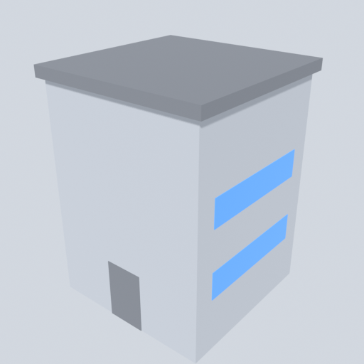 | Building_Small_01 | 6.40 × 6.40 × 8.40 | 60 | Simple blockout: body, roof slab, window bands, door | [Blend](Building_Small_01/Building_Small_01.blend) · [FBX](Building_Small_01/Building_Small_01.fbx) · [PNG](Building_Small_01/Building_Small_01_preview.png) · [Specs](Building_Small_01/Building_Small_01_specs.json) |
| 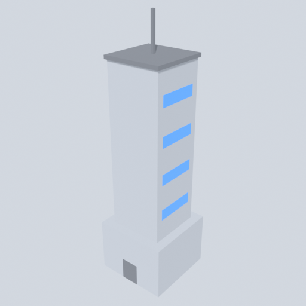 | Building_Tall_01 | 8.00 × 8.05 × 28.40 | 108 | Simple blockout: base, tower, window bands, antenna | [Blend](Building_Tall_01/Building_Tall_01.blend) · [FBX](Building_Tall_01/Building_Tall_01.fbx) · [PNG](Building_Tall_01/Building_Tall_01_preview.png) · [Specs](Building_Tall_01/Building_Tall_01_specs.json) |
| 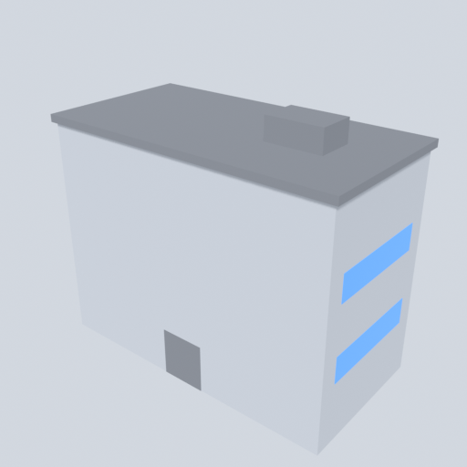 | Building_Block_01 | 16.40 × 8.40 × 13.60 | 72 | Simple blockout: wide body, roof slab, window bands, vent | [Blend](Building_Block_01/Building_Block_01.blend) · [FBX](Building_Block_01/Building_Block_01.fbx) · [PNG](Building_Block_01/Building_Block_01_preview.png) · [Specs](Building_Block_01/Building_Block_01_specs.json) |
| 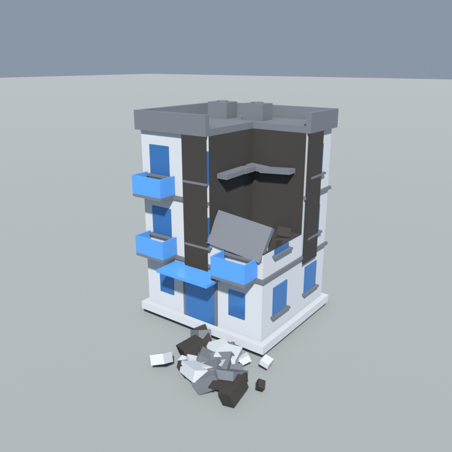 | Building_Small_02_Damaged | 8.99 × 10.34 × 10.95 | 1,788 | Building_Small_02 with the upper front-right corner collapsed, scorched interior, broken floor slabs, and a rubble pile | [Blend](Building_Small_02_Damaged/Building_Small_02_Damaged.blend) · [FBX](Building_Small_02_Damaged/Building_Small_02_Damaged.fbx) · [PNG](Building_Small_02_Damaged/Building_Small_02_Damaged_preview.png) · [Specs](Building_Small_02_Damaged/Building_Small_02_Damaged_specs.json) |
| 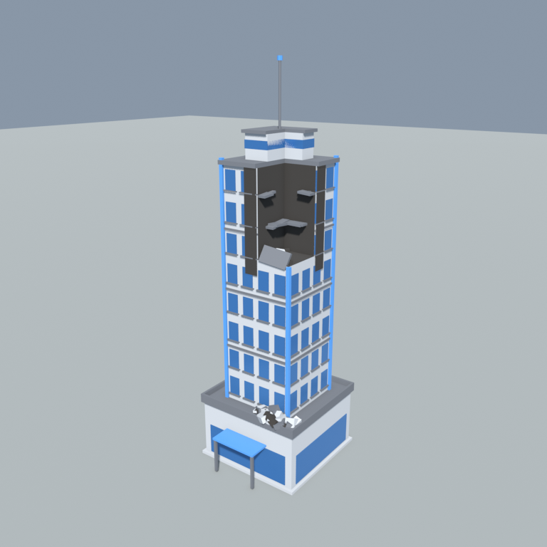 | Building_Tall_02_Damaged | 11.60 × 13.50 × 39.85 | 4,424 | Building_Tall_02 with the top three floors' front-right corner destroyed and rubble on the podium roof | [Blend](Building_Tall_02_Damaged/Building_Tall_02_Damaged.blend) · [FBX](Building_Tall_02_Damaged/Building_Tall_02_Damaged.fbx) · [PNG](Building_Tall_02_Damaged/Building_Tall_02_Damaged_preview.png) · [Specs](Building_Tall_02_Damaged/Building_Tall_02_Damaged_specs.json) |
| 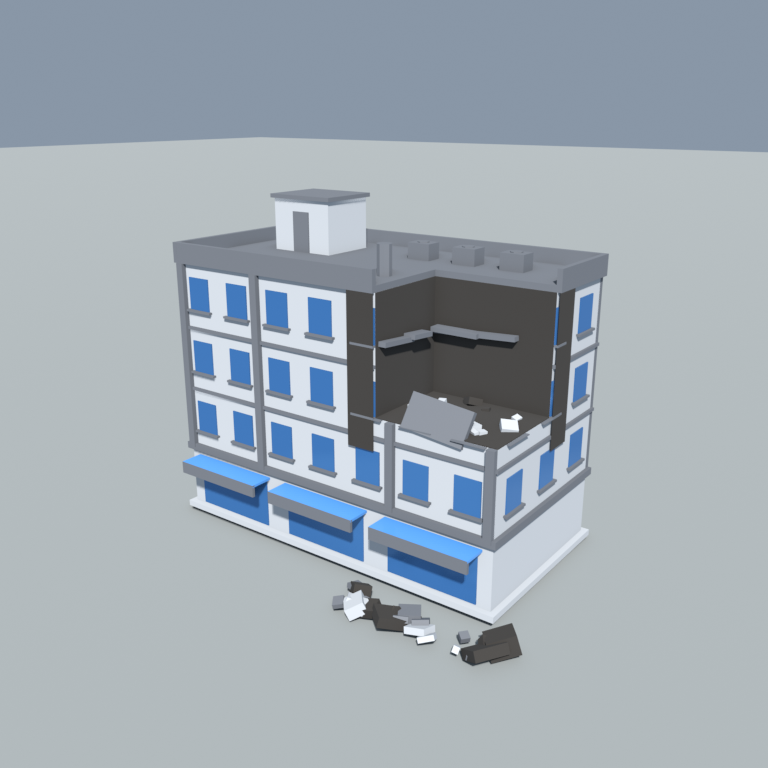 | Building_Block_02_Damaged | 20.63 × 13.85 × 16.60 | 2,844 | Building_Block_02 with the upper front-right section collapsed | [Blend](Building_Block_02_Damaged/Building_Block_02_Damaged.blend) · [FBX](Building_Block_02_Damaged/Building_Block_02_Damaged.fbx) · [PNG](Building_Block_02_Damaged/Building_Block_02_Damaged_preview.png) · [Specs](Building_Block_02_Damaged/Building_Block_02_Damaged_specs.json) |
| 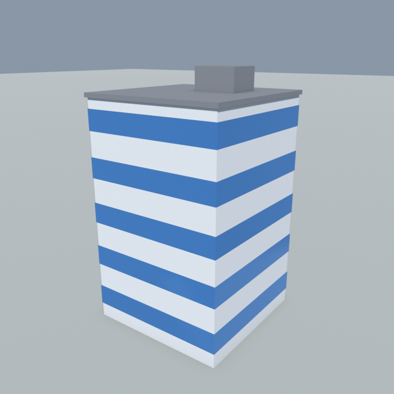 | Building_Background_01 | 10.30 × 10.30 × 17.90 | 96 | Five-storey skyline filler with ribbon windows | [Blend](Building_Background_01/Building_Background_01.blend) · [FBX](Building_Background_01/Building_Background_01.fbx) · [PNG](Building_Background_01/Building_Background_01_preview.png) · [Specs](Building_Background_01/Building_Background_01_specs.json) |
| 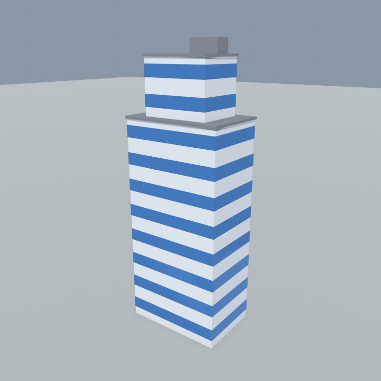 | Building_Background_02 | 12.30 × 8.30 × 34.20 | 180 | Ten-storey skyline filler with a setback top | [Blend](Building_Background_02/Building_Background_02.blend) · [FBX](Building_Background_02/Building_Background_02.fbx) · [PNG](Building_Background_02/Building_Background_02_preview.png) · [Specs](Building_Background_02/Building_Background_02_specs.json) |
| 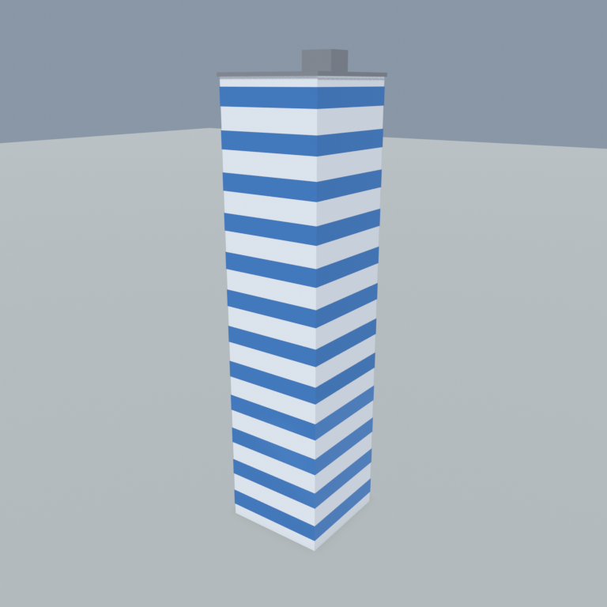 | Building_Background_03 | 9.30 × 9.30 × 40.30 | 180 | Twelve-storey slim skyline filler | [Blend](Building_Background_03/Building_Background_03.blend) · [FBX](Building_Background_03/Building_Background_03.fbx) · [PNG](Building_Background_03/Building_Background_03_preview.png) · [Specs](Building_Background_03/Building_Background_03_specs.json) |
| 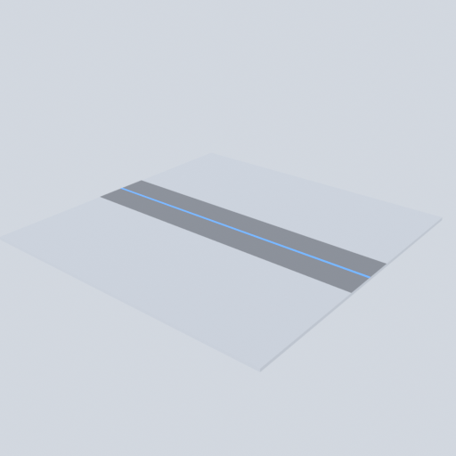 | Ground_Tile_01 | 20.00 × 20.00 × 0.23 | 36 | Flat 20 m slab with a plain road strip; superseded by the road tiles below | [Blend](Ground_Tile_01/Ground_Tile_01.blend) · [FBX](Ground_Tile_01/Ground_Tile_01.fbx) · [PNG](Ground_Tile_01/Ground_Tile_01_preview.png) · [Specs](Ground_Tile_01/Ground_Tile_01_specs.json) |

### Road and park tiles

Every tile is **20 × 20 m** with its origin at the tile centre and the road surface at height 0. Each has a 10 m two-lane road and 5 m raised sidewalks with curbs. Place tiles on a 20 m grid and rotate them in 90° steps; lane dashes repeat every 4 m, so markings continue across tile edges.

| Preview | Asset | Dimensions (m) | Triangles | Description | Files |
|---|---|---|---:|---|---|
| 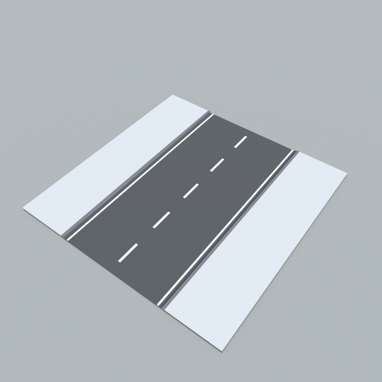 | Road_Straight_01 | 20.00 × 20.00 × 0.37 | 288 | Straight road with dashed centre line and edge lines | [Blend](Road_Straight_01/Road_Straight_01.blend) · [FBX](Road_Straight_01/Road_Straight_01.fbx) · [PNG](Road_Straight_01/Road_Straight_01_preview.png) · [Specs](Road_Straight_01/Road_Straight_01_specs.json) |
| 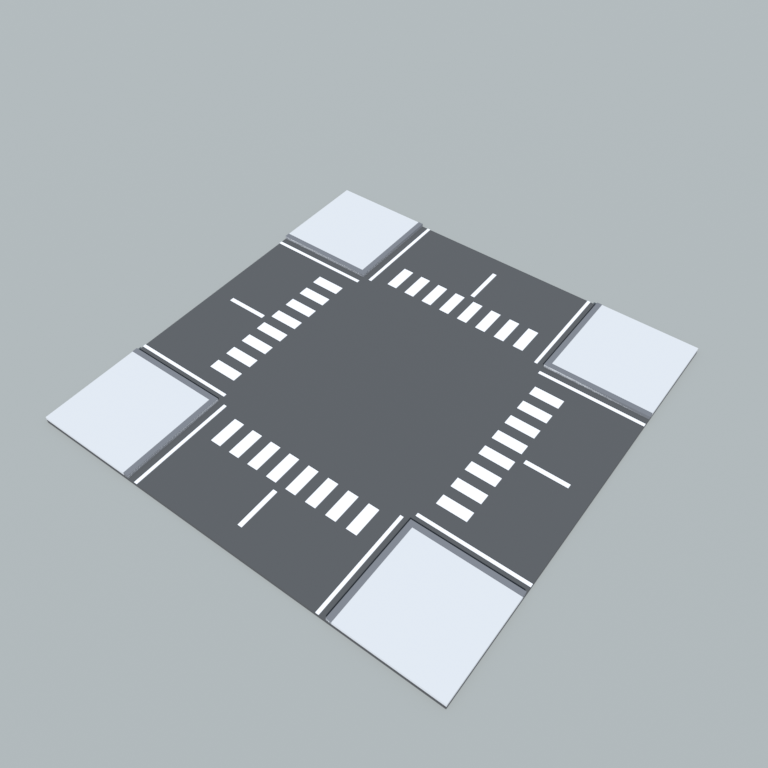 | Road_Cross_01 | 20.00 × 20.00 × 0.37 | 684 | Four-way crossroads with crosswalks on every arm | [Blend](Road_Cross_01/Road_Cross_01.blend) · [FBX](Road_Cross_01/Road_Cross_01.fbx) · [PNG](Road_Cross_01/Road_Cross_01_preview.png) · [Specs](Road_Cross_01/Road_Cross_01_specs.json) |
| 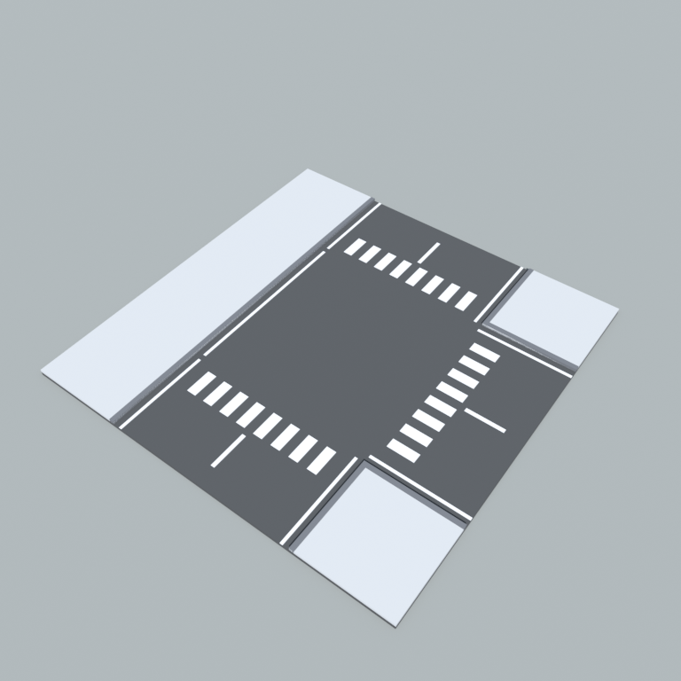 | Road_T_01 | 20.00 × 20.00 × 0.37 | 588 | T-junction with crosswalks | [Blend](Road_T_01/Road_T_01.blend) · [FBX](Road_T_01/Road_T_01.fbx) · [PNG](Road_T_01/Road_T_01_preview.png) · [Specs](Road_T_01/Road_T_01_specs.json) |
| 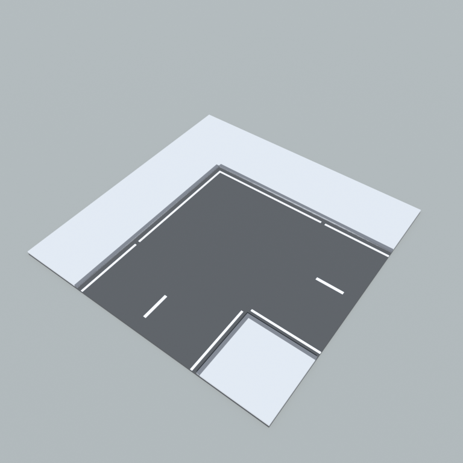 | Road_Corner_01 | 20.00 × 20.00 × 0.37 | 300 | 90° turn | [Blend](Road_Corner_01/Road_Corner_01.blend) · [FBX](Road_Corner_01/Road_Corner_01.fbx) · [PNG](Road_Corner_01/Road_Corner_01_preview.png) · [Specs](Road_Corner_01/Road_Corner_01_specs.json) |
| 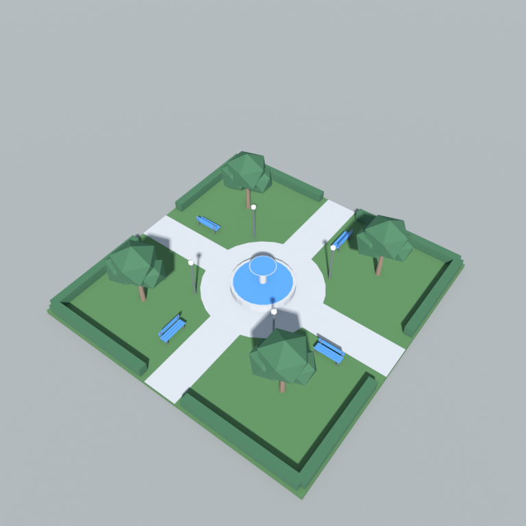 | Park_Tile_01 | 20.00 × 20.00 × 5.39 | 1,620 | Lawn with cross paths, central fountain plaza, hedges, four trees, lamps, and benches; its surface sits at sidewalk height (0.15 m) | [Blend](Park_Tile_01/Park_Tile_01.blend) · [FBX](Park_Tile_01/Park_Tile_01.fbx) · [PNG](Park_Tile_01/Park_Tile_01_preview.png) · [Specs](Park_Tile_01/Park_Tile_01_specs.json) |

### Street props

| Preview | Asset | Dimensions (m) | Triangles | Description | Files |
|---|---|---|---:|---|---|
| 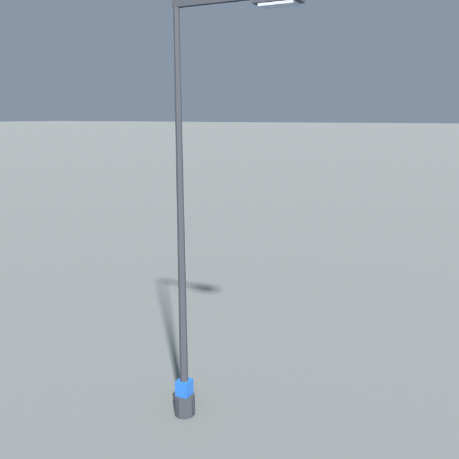 | Streetlight_01 | 2.29 × 0.40 × 7.40 | 120 | Tapered pole with an arm reaching 1.75 m along +X; place on a sidewalk with the arm over the road | [Blend](Streetlight_01/Streetlight_01.blend) · [FBX](Streetlight_01/Streetlight_01.fbx) · [PNG](Streetlight_01/Streetlight_01_preview.png) · [Specs](Streetlight_01/Streetlight_01_specs.json) |
| 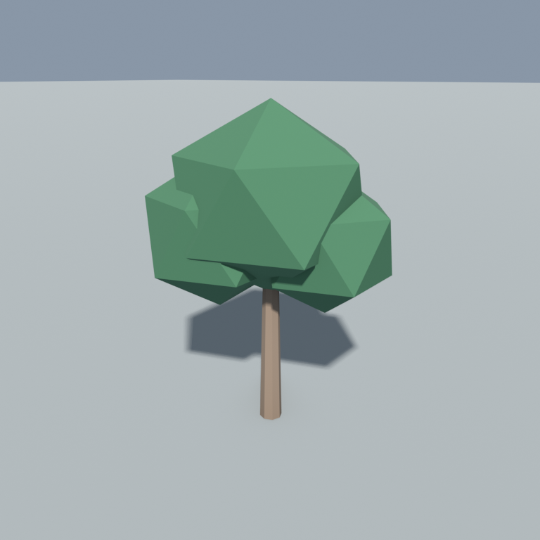 | Tree_01 | 3.56 × 2.78 × 5.04 | 88 | Round deciduous tree | [Blend](Tree_01/Tree_01.blend) · [FBX](Tree_01/Tree_01.fbx) · [PNG](Tree_01/Tree_01_preview.png) · [Specs](Tree_01/Tree_01_specs.json) |
| 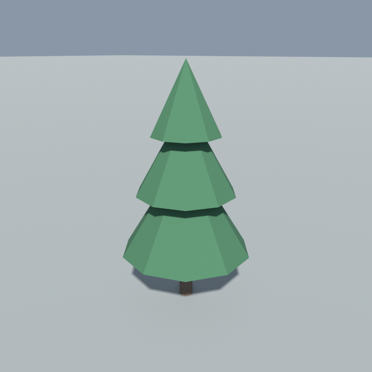 | Tree_02 | 2.85 × 3.00 × 5.50 | 82 | Three-tier pine tree | [Blend](Tree_02/Tree_02.blend) · [FBX](Tree_02/Tree_02.fbx) · [PNG](Tree_02/Tree_02_preview.png) · [Specs](Tree_02/Tree_02_specs.json) |
| 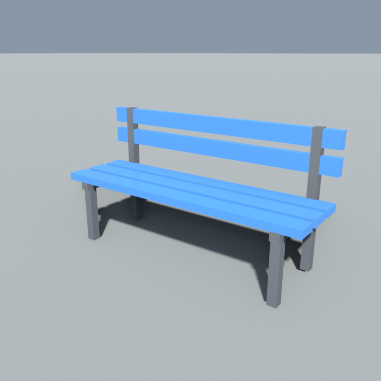 | Bench_01 | 1.80 × 0.55 × 0.94 | 132 | Slatted park bench | [Blend](Bench_01/Bench_01.blend) · [FBX](Bench_01/Bench_01.fbx) · [PNG](Bench_01/Bench_01_preview.png) · [Specs](Bench_01/Bench_01_specs.json) |
| 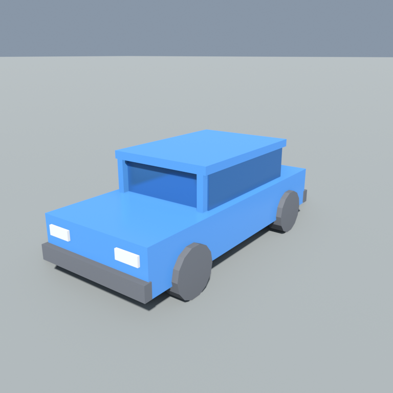 | Car_01 | 1.98 × 4.38 × 1.57 | 340 | Blue sedan, static (wheels are not separate objects) | [Blend](Car_01/Car_01.blend) · [FBX](Car_01/Car_01.fbx) · [PNG](Car_01/Car_01_preview.png) · [Specs](Car_01/Car_01_specs.json) |
| 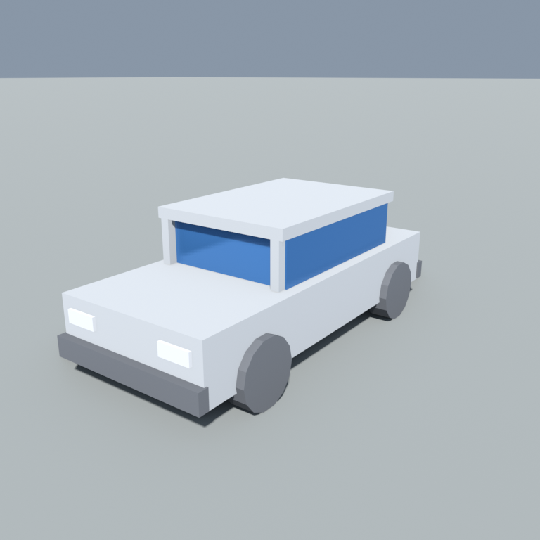 | Car_02 | 1.98 × 4.38 × 1.57 | 340 | White variant of Car_01 | [Blend](Car_02/Car_02.blend) · [FBX](Car_02/Car_02.fbx) · [PNG](Car_02/Car_02_preview.png) · [Specs](Car_02/Car_02_specs.json) |

### Terrain

| Preview | Asset | Dimensions (m) | Triangles | Description | Files |
|---|---|---|---:|---|---|
| 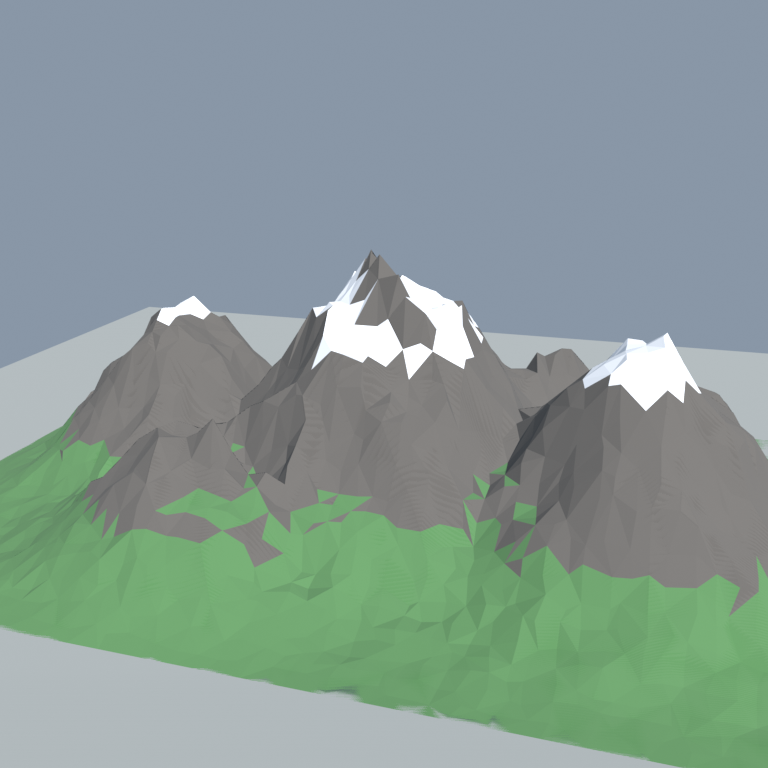 | Mountain_01 | 520.00 × 340.00 × 148.03 | 4,800 | Faceted low-poly mountain group with five peaks, grass foothills, rock slopes, and snow caps. Its edges fall to ground level, so rotated and scaled copies can be overlapped into a range | [Blend](Mountain_01/Mountain_01.blend) · [FBX](Mountain_01/Mountain_01.fbx) · [PNG](Mountain_01/Mountain_01_preview.png) · [Specs](Mountain_01/Mountain_01_specs.json) |

### Environment kit conventions

- **Origin:** buildings and props sit on the ground with the origin at their base centre; road tiles use the tile centre.
- **Facing:** entrances, car fronts, and headlights face Blender −Y. FBXs use the same **+Z forward / +Y up** export setting as the scenario assets; confirm the facing after import.
- **Hierarchy:** each asset is an empty root named after the asset, with one child mesh per material (for example `Building_Tall_02_Windows`). This keeps draw calls low and makes materials easy to swap in Unity.
- **Materials:** `SHIELD_LightGray` (walls, sidewalks), `SHIELD_DarkGray` (trim, curbs, wheels), `SHIELD_Glass` (windows), `SHIELD_Blue` (accents), `SHIELD_Asphalt`, `SHIELD_White` (road markings), `SHIELD_Foliage`, `SHIELD_Bark`, `SHIELD_Grass`, `SHIELD_Rock` and `SHIELD_Snow` (terrain), `SHIELD_Scorched` (damage), and `SHIELD_ThreatRed` (threat models only).
- **Moving parts:** launchers and the two new radars place each moving part under its own pivot object (`<Asset>_Pod`, `_Rack`, `_Canister`, `_Head`, `_Array`). These five FBXs keep the axis conversion on the root instead of baking it into the meshes, so their root may import with a rotation in Unity. Enable **Bake Axis Conversion** in the model import settings, or leave the root rotation as imported.
- **Specs JSON:** every new asset has `<AssetName>_specs.json` with relative file names, dimensions, triangle counts, parts, and pivots.
- **Previews:** rendered with a temporary ground plane, sun, and sky that are not part of the exported model.

## City scene

[`City_Scene_01/`](City_Scene_01/) holds a defended city assembled in Blender from 293 instances of the assets above, with renders from three cameras.

| File | Contents |
|---|---|
| [City_Scene_01.blend](City_Scene_01/City_Scene_01.blend) | The scene, with cameras `Cam_Aerial`, `Cam_Street`, and `Cam_Map` (orthographic, top-down) |
| [City_Scene_01_aerial.png](City_Scene_01/City_Scene_01_aerial.png) | Wide aerial view toward the mountains |
| [City_Scene_01_street.png](City_Scene_01/City_Scene_01_street.png) | Street-level view up the main north–south avenue |
| [City_Scene_01_map.png](City_Scene_01/City_Scene_01_map.png) | Top-down map of the layout |

**Layout**
- **Grid:** 9 × 9 tiles on the 20 m grid (about 180 m across). Avenues run every third tile, and the two central avenues extend out of the city.
- **Downtown:** the central paved blocks hold the towers and large blocks.
- **Outer ring:** grass lots with smaller buildings and trees.
- **Park:** four Park_Tile_01 tiles together form a 40 m park in the north-west block.
- **Damage:** the three `_Damaged` buildings sit among intact ones.
- **Defense sites:** a short-range battery (Launcher_ShortRange_01 + Radar_Panel_01) sits inside the city at the south-west corner. Three sites sit outside it:
  - **East:** Command_Center_01, Radar_01, and two mid-range launchers.
  - **West:** Radar_Array_01 and two mid-range launchers.
  - **North-east:** Radar_Array_01 and three long-range launchers.
- **Mountains:** seven Mountain_01 copies form a range about 700–1,100 m north of the city.

**Notes**
- Each asset is stored once in a hidden `ASSET_<Name>` collection and placed with collection-instance empties. The file stays small (about 0.4 MB), and an instance can be moved or swapped without editing meshes.
- Radar_01 is brought in from its FBX, because its Blender 5.0 `.blend` cannot be read by Blender 3.x.
- Lighting is an EEVEE sun with a flat blue sky and a light world-volume haze. The haze is a Blender render setting and does not transfer to Unity.
- The scene is a Blender layout reference; it is not exported as a single FBX. For Unity, recreate the layout from the individual asset FBXs, using the map render as a guide.

## File conventions

| File | Purpose |
|---|---|
| `<AssetName>.blend` | Editable, asset-only Blender source |
| `<AssetName>.fbx` | Exchange model for Unity |
| `<AssetName>_preview.png` | Rendered preview used by these READMEs |
| `<AssetName>_specs.json` | Additional metadata where available |

The previews and file links are relative to this `3D_assets/README.md`. Keep each asset's files together and preserve filename spelling and capitalization for GitHub compatibility.

## Unity import checklist

1. Copy the FBX into `Assets/Models/<AssetName>/` in the Unity project.
2. Place the model in a test scene and inspect it from several angles.
3. Confirm metre scale and the reported **+Z forward / +Y up** orientation.
4. Check materials in the project's rendering pipeline.
5. Inspect child objects and test propeller or mount rotation where applicable.
6. Create a prefab after verification.

The creation reports state that the FBXs passed re-import checks for transforms, hierarchy, materials, and relevant pivots. They also report checks of normals and closed geometry. Repeat the relevant checks in Unity before using the assets in a larger scene.

## Working on more assets

- Create each new asset in a separate Blender scene or file.
- Use the same simple material palette and clear object names.
- Keep moving parts separate with appropriate pivots.
- Save the Blender source before exporting.
- Save a preview with the same filename pattern.
- Check for existing files before overwriting; use numbered versions for revisions.
- Update this catalog when a new asset is added.

Read the [Blender MCP Windows guide](../Blender_MCP_Windows_Guide.md) for connection setup and the restart checklist.

[Back to project README](../README.md) · [Project roadmap](../SHIELD_AI_ROADMAP.md)
