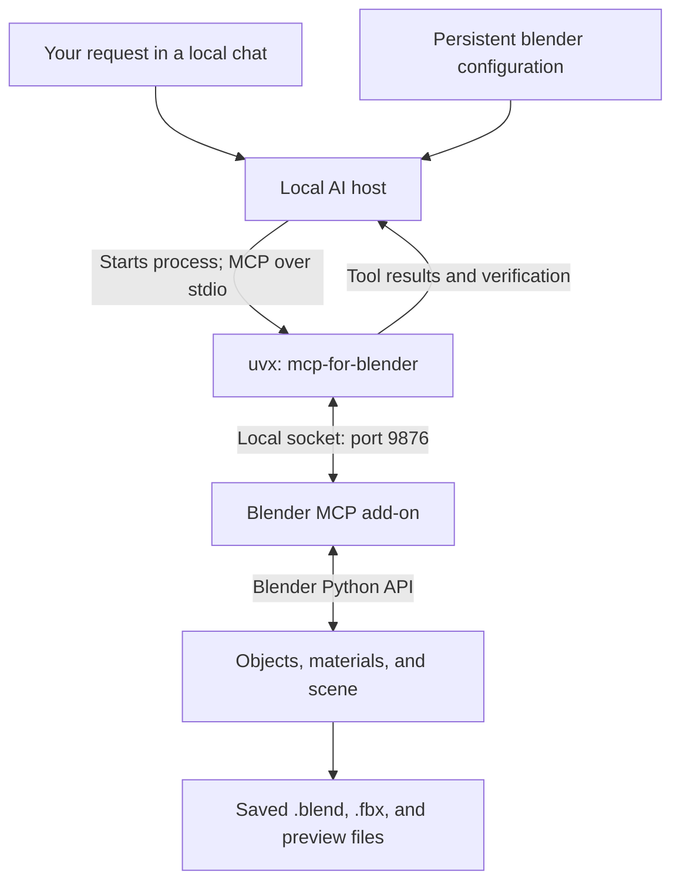
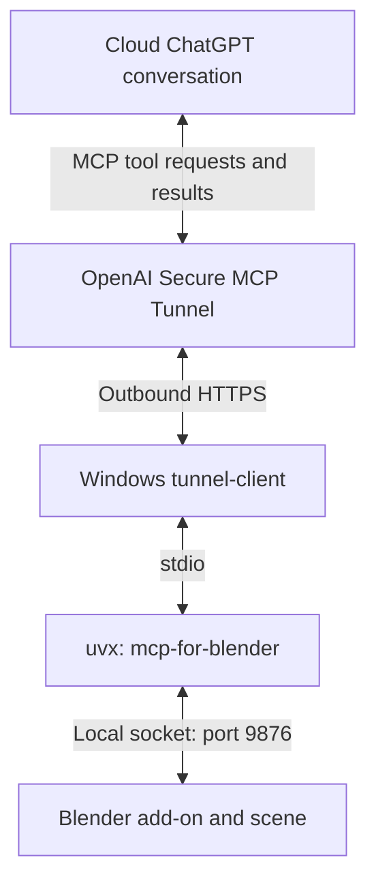

# Blender MCP on Windows: setup and daily use

This guide records Muhammad Ahmad Khan’s working local Blender connection and explains how to reuse it after closing everything.

## 1. Current working setup

| Component | Your setup |
|---|---|
| Operating system | Windows |
| Blender | 5.2.2 LTS, as shown in your screenshot |
| Blender add-on | MCP for Blender, version 1.8 |
| Add-on socket | `localhost:9876` |
| Companion MCP server | `mcp-for-blender`, launched through `uvx.exe` |
| Executable | `C:\Users\Muhammad Ahmad\.local\bin\uvx.exe` |
| Persistent local MCP connection name | `blender` |
| Blender Work plugin | Prepared; installation was blocked, so do not assume it is installed |
| Cloud tunnel | Pending; not needed for the working local route |

The other local conversation reported creating a blue cube, changing its material to green, and separately reading the result. It later reported creating and exporting Radar_01. These operations establish that the local route worked in that host; this guide does not independently inspect that computer.

**For your current setup, go directly to Section 4. You do not need to reinstall anything each time.**

## 2. How it works



| Part | Plain-language explanation |
|---|---|
| Local AI host | Runs tools on your Windows computer. The model can be remote while tool execution remains local. |
| Persistent configuration | Tells the host how to start the Blender companion server in future sessions. |
| `uvx` | Launches the Python package that provides MCP tools. |
| Companion MCP server | Translates tool requests into commands the Blender add-on understands. |
| Blender add-on | Receives local commands and uses Blender’s Python API to inspect or edit the scene. |
| Verification | A separate read checks the result instead of assuming a command worked. |

**“Connected on port 9876” in Blender means its local socket server is active. It does not prove a chat host is connected. Confirm that by asking the host to inspect the scene.**

Port 9876 is not an HTTP MCP endpoint. Do not enter `http://localhost:9876` as a ChatGPT plugin URL.

## 3. First-time setup on Windows

### Step 1 — Install uv

Open PowerShell and run the official installer:

```powershell
powershell -c "irm https://astral.sh/uv/install.ps1 | iex"
```

Close and reopen PowerShell, then check:

```powershell
uv --version
uvx --version
```

If PowerShell still says `uv` is not recognized, update PATH for the current terminal:

```powershell
$env:Path = "$env:USERPROFILE\.local\bin;$env:Path"
uv --version
```

This command affects only the current session. A fresh shell normally picks up the installer’s PATH change. To bypass PATH entirely, use:

```powershell
& "$env:USERPROFILE\.local\bin\uv.exe" --version
```

### Step 2 — Install the Blender add-on

Close Blender before installation, then run:

```powershell
& "$env:USERPROFILE\.local\bin\uvx.exe" mcp-for-blender install-addon
```

Open Blender and go to **Edit → Preferences → Add-ons**. Search for **MCP for Blender** and enable it. If it does not appear, restart Blender and check the installer’s output for the destination it used. Multiple installed Blender versions may have separate add-on folders.

The current package is `mcp-for-blender`; older instructions may call it `blender-mcp`.

### Step 3 — Start the Blender side

1. Close Preferences.
2. Move your mouse over the 3D viewport and press **N**.
3. Click the vertical **MCP for Blender** sidebar tab.
4. Click **Start MCP Server** if it is not already running.
5. Confirm that the panel says **Connected on port 9876**.

The add-on may start automatically. If you see **Disconnect**, it is already running. Hyper3D, Hunyuan3D, and premium generation services are optional; leave their API fields empty for ordinary scripted modeling.

### Step 4 — Register the companion server in a local host

Use a host that supports **local stdio MCP servers**. Installing the Blender add-on alone does not configure ChatGPT’s cloud connection.

Your working local host was configured with:

```text
Connection name: blender
Command: C:\Users\Muhammad Ahmad\.local\bin\uvx.exe
Arguments: mcp-for-blender
Transport: stdio
```

When the host has separate command and arguments fields, enter the executable path as the command and `mcp-for-blender` as the argument. Do not paste the whole command line into an executable-path field.

If using the Codex CLI specifically, its documented registration command can be adapted to your absolute path:

```powershell
codex mcp add blender -- "C:\Users\Muhammad Ahmad\.local\bin\uvx.exe" mcp-for-blender
codex mcp list
```

These commands require an installed Codex CLI; they are not commands for a generic ChatGPT settings screen. For your existing local desktop host, keep the persistent configuration already created. Its exact configuration file location was not included in the report, so this guide does not invent one.

Restart the local host after changing its MCP configuration. Let it launch the companion process; do not also launch another copy manually or enable the plugin’s bundled server at the same time.

### Step 5 — Test a read, then a write

First ask:

> Use the blender MCP connection to inspect the current scene. List object names without changing anything.

Then ask:

> Create a small blue cube named MCP_Connection_Test in a new collection named MCP_Tests. Preserve all existing objects. If that name already exists, inspect it instead of creating a duplicate. Verify its location and material with a separate read.

If both succeed, the connection is working. Save your Blender file to preserve the test object if you want to inspect it after reopening Blender.

## 4. After closing everything or restarting Windows

**Normal startup checklist:**

1. Open Blender.
2. Open the `.blend` file you want to work on. Opening a new file may reset the add-on’s server state, so check it afterward.
3. Press **N → MCP for Blender** and confirm **Connected on port 9876**. Click **Start MCP Server** only if necessary.
4. Open your local AI host. Restart it if it has not reloaded the persistent MCP configuration.
5. Start a new local conversation with the `blender` MCP tools enabled or available.
6. Ask for a read-only scene inspection before requesting edits.
7. Proceed with modeling once the read succeeds.

Use this startup prompt:

> Use the persistent local blender MCP connection. Inspect the currently open Blender scene and report its object names without modifying anything. Do not install plugins, change connection settings, or start a duplicate companion server.

If you opened the saved radar file, you can instead ask:

> Use the blender MCP connection to inspect Radar_01. Identify its base, rotating mount, and dish, and report their transforms without changing anything.

An unsaved test cube will not necessarily exist after a restart. A missing `ChatGPT_Blue_Cube` does not by itself mean the connection failed; ask for all scene object names.

### What persists and what must run again?

| Item | Survives closing everything? | Next-session action |
|---|---|---|
| uv installation | Yes | None |
| Installed Blender add-on | Yes | Check that it remains enabled |
| Persistent local MCP registration | Normally yes | Let the host load it |
| Saved `.blend`, `.fbx`, and PNG files | Yes | Open or import as needed |
| Unsaved Blender edits | No | Save before closing |
| Blender socket server | No running process after Blender closes | Open Blender and check/start it |
| Companion MCP process | Do not assume it stays running | Let the host launch it again |
| Conversation context | Host-dependent | State the file and task in a new chat |
| PowerShell session PATH adjustment | No | Use a fresh shell or the absolute executable path |

## 5. Closing safely

1. Finish the current tool operation.
2. Save your `.blend` file and any required exports.
3. Ask the agent to verify the saved files exist.
4. Close the local AI host and Blender.
5. If you ran a temporary server or tunnel manually, stop it with **Ctrl+C** in its terminal.

Saving a rendered preview does not save the editable Blender scene. Save the `.blend` separately.

## 6. Safe asset workflow for SHIELD_AI

Your asset folder is:

```text
E:\GitHub repo\SHIELD_AI\3D_assets
```

Use one subfolder per asset, such as `Radar_01`. Prefer a separate Blender scene or file for each new asset: the radar creation report mentioned an operation error that removed and then restored test objects.

Reusable modeling prompt:

> Use the working blender MCP connection to create [ASSET NAME] in a separate Blender scene or file. Preserve existing work. Save an asset-only .blend, a Unity-ready .fbx, and a PNG preview under E:\GitHub repo\SHIELD_AI\3D_assets\[ASSET NAME]\. Check for existing files and use a numbered version instead of overwriting them. Verify saved files, mesh normals, transforms, relevant animation pivots, and FBX re-import. Show the preview and report the triangle count.

Spaces in your path are valid. Quote the path when using it in shell commands.

## 7. Troubleshooting

| Symptom | What to do |
|---|---|
| `uv` or `uvx` not recognized | Reopen PowerShell; use the session PATH command in Section 3 or the full executable path. |
| Add-on missing | Check installer output, Blender version, and Add-ons preferences; restart Blender. |
| Cannot find MCP tab | Hover over the 3D viewport, press N, and inspect the vertical tabs at its right edge. |
| Blender panel says connected, but chat cannot inspect it | Check local MCP registration and whether the host loaded its tools. The panel only confirms Blender’s socket is running. |
| Connection refused | Check that Blender is open and the add-on is listening on the expected host and port. |
| Address already in use | Look for an existing add-on listener or another Blender instance; avoid multiple servers competing for the same port. |
| No Blender tools in a new chat | Restart the local host and check the persistent MCP entry. A cloud-only chat cannot automatically use a local stdio process. |
| Test cube is missing | Open the saved scene or list current objects; unsaved scenes do not survive shutdown. |
| Plugin installation blocked | Continue with the verified standalone `blender` connection. Plugin installation is not required for that route. |
| Blender Work plugin is installed later | Disable the standalone registration before enabling the plugin’s equivalent bundled server, to avoid duplicates. |
| Material looks different in Unity | Check the imported materials and the project’s rendering pipeline; verify it in Unity rather than relying only on Blender’s render. |

## 8. Optional cloud ChatGPT route

**This is separate from your verified local setup. Skip it if the local conversation already meets your needs.**



This route needs a real tunnel ID, local runtime credentials, appropriate Platform tunnel permissions, workspace association, and permitted ChatGPT developer-mode access. Keep API keys out of chat and plugin archives.

Use the official Secure MCP Tunnel guide for setup. Keep Blender and `tunnel-client` running during use. Avoid running the local host’s companion and the tunnel’s companion concurrently.

The **Browser → Developer mode → Enable full CDP access** toggle shown in your screenshot controls browser access. It does not configure this Blender MCP connection.

## 9. Sources and scope

- [MCP for Blender: installation, local clients, and add-on instructions](https://github.com/ahujasid/mcp-for-blender)
- [uv: official installation instructions](https://docs.astral.sh/uv/getting-started/installation/)
- [OpenAI: MCP configuration guidance](https://developers.openai.com/learn/docs-mcp)
- [OpenAI: Secure MCP Tunnel](https://developers.openai.com/api/docs/guides/secure-mcp-tunnels)
- [OpenAI: connecting an MCP server in ChatGPT](https://developers.openai.com/plugins/deploy/connect-chatgpt)

Prepared on 4 October 2026 from the setup instructions, screenshots, and successful local-operation reports shared in this conversation. UI labels and package behavior can change; preserve the distinction between a local stdio host and a cloud tunnel.
