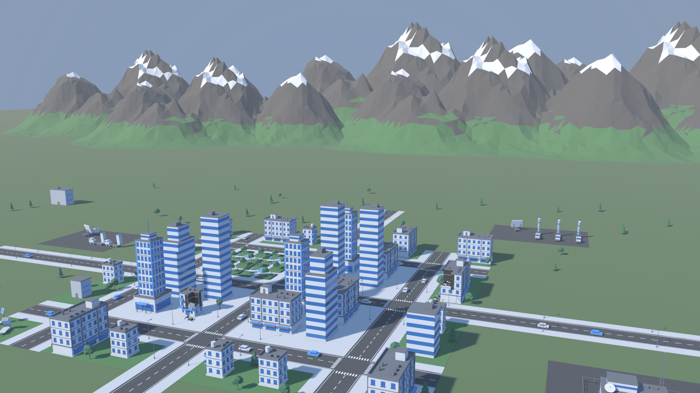
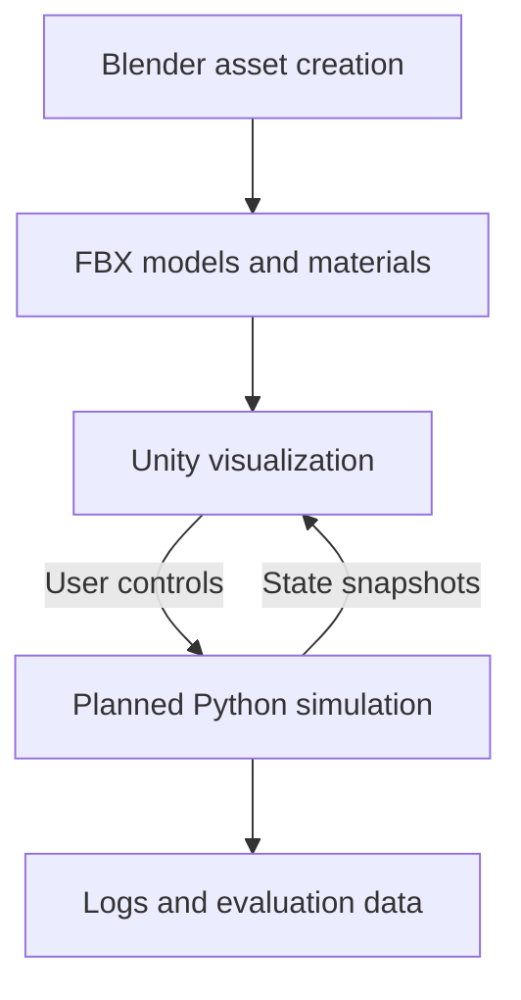

# SHIELD_AI

**An educational 3D simulation project combining Unity visualization, Blender assets, and a planned Python analysis backend.**

SHIELD_AI explores an abstract layered defense scenario using fictional or stylized objects. The project is currently in the **asset preparation stage**. The repository contains 40 3D assets in three groups: the original scenario assets, a defense scenario kit, and a city environment kit. It also has an assembled and rendered city scene, the assets' previews, a project roadmap, and a Windows Blender MCP setup guide.

The models are nonfunctional exterior visuals. The project does not claim to reproduce or validate the performance of real defense systems.

## Current progress

| Area | Status |
|---|---|
| Radar asset | Created |
| FPV quadcopter asset | Created |
| Stylized delta-wing drone asset | Created |
| Generic missile exterior asset | Created |
| Threat models (ballistic, hypersonic glider; Generic_Missile_01 as cruise) | Created; Unity check pending |
| Interceptors, launchers, and radars for three defense layers | Created; Unity check pending |
| Command center building | Created; Unity check pending |
| City buildings (3 detailed, 3 damaged, 3 blockouts, 3 background) and ground tile | Created; Unity check pending |
| Road and park tiles (straight, crossroads, T-junction, corner, park) | Created; Unity check pending |
| Street props (streetlight, 2 trees, bench, 2 cars) | Created; Unity check pending |
| Mountain terrain asset | Created; Unity check pending |
| Assembled city scene with renders (Blender) | Created |
| Local Blender MCP connection | Configured and tested in the author's local host |
| Unity integration | Planned |
| Python simulation and analysis | Planned |
| Machine learning experiments | Planned |

Asset creation reports describe successful FBX re-import checks for the four original scenario assets. The defense scenario kit and the city environment kit FBXs were re-imported into Blender and matched their specs. Unity integration still needs to be checked in the actual Unity project.

## 3D assets

### Original scenario assets

| Asset | Triangles | Description |
|---|---:|---|
| Radar_01 | 1,856 | Base, rotating mount, and dish |
| FPV_Quadcopter_01 | 972 | Quadcopter with separate propellers |
| Shahed_Style_Drone_01 | 256 | Stylized delta-wing drone with rear propeller |
| Generic_Missile_01 | 420 | Fictional exterior model |
| **Total** | **3,504** | Four reusable assets |

### Defense scenario kit

| Group | Assets | Triangles |
|---|---|---:|
| Threats | Threat_Ballistic_01, Threat_Hypersonic_01 | 550 |
| Interceptors | Interceptor_ShortRange_01, Interceptor_MidRange_01, Interceptor_LongRange_01 | 1,300 |
| Launchers | Launcher_ShortRange_01, Launcher_MidRange_01, Launcher_LongRange_01 (elevating parts) | 3,852 |
| Radars | Radar_Panel_01, Radar_Array_01 (rotating heads) | 1,648 |
| Command | Command_Center_01 | 1,472 |
| **Total** | **11 assets** | **8,822** |

### City environment kit

| Group | Assets | Triangles |
|---|---|---:|
| Buildings and ground | Three `_02` buildings, their `_Damaged` variants, three `_01` blockouts, three background buildings, Ground_Tile_01 | 16,624 |
| Road and park tiles | Road_Straight_01, Road_Cross_01, Road_T_01, Road_Corner_01, Park_Tile_01 (20 m grid) | 3,480 |
| Street props | Streetlight_01, Tree_01, Tree_02, Bench_01, Car_01, Car_02 | 1,102 |
| Terrain | Mountain_01 | 4,800 |
| **Total** | **25 assets** | **26,006** |

### City scene

`3D_assets/City_Scene_01/` contains a Blender scene that assembles 293 instances of these assets. The city is a 9 × 9-tile grid with a downtown core, a park, and damaged buildings. Defense sites sit inside and outside the city, with a mountain range to the north. Renders are included from aerial, street-level, and top-down map cameras. The scene is a layout reference for rebuilding the city in Unity, not a single export.

See the [illustrated asset catalog](3D_assets/README.md) for previews, model downloads, dimensions, specifications, and import notes.

## Repository contents

| Path | Contents |
|---|---|
| [3D_assets/](3D_assets/) | Blender source files, FBX exports, previews, and available specifications |
| [SHIELD_AI_ROADMAP.md](SHIELD_AI_ROADMAP.md) | Project plan and proposed architecture |
| [Blender_MCP_Windows_Guide.md](Blender_MCP_Windows_Guide.md) | First-time local setup, restart checklist, and troubleshooting |

The roadmap describes intended work; its presence does not imply those features have been implemented.

## Tools

| Tool | Role |
|---|---|
| Blender | Model creation, materials, pivots, and FBX export |
| Unity | Planned scene visualization, animation, and interface |
| Python | Planned simulation, data processing, and analysis |
| MCP for Blender | Local tool connection for assisted Blender modeling |
| Git | Version control |

## Getting started with the assets

1. Open an asset's `.blend` file in Blender to inspect or edit its source.
2. Copy its `.fbx` file into the Unity project's `Assets/Models/` folder.
3. Place the imported model in a test scene.
4. Check scale, orientation, hierarchy, and material appearance.
5. Check the radar mount or propeller pivots before adding animation.
6. Create a Unity prefab after the import looks correct.

The reported export convention is **Unity +Z forward / +Y up**. Assets use simple gray and blue materials; threat models add red, and the city kit adds asphalt, road-marking white, foliage, bark, grass, and scorch marks. Rendering-pipeline differences may require material adjustments in Unity.

## Planned software structure

This diagram is a proposed separation of responsibilities, not a description of a completed backend.

## Next milestones

- Import and check all asset kits in Unity, including the launcher and radar pivots.
- Create reusable prefabs and rebuild the City_Scene_01 layout in Unity from them.
- Demonstrate Python-to-Unity communication with a moving cube.
- Add logging, pause/restart controls, and reproducible replay.

## Author

Muhammad Ahmad Khan

BS Computer Science, UET Peshawar — Nowshera Campus

## License

No license file was included in the supplied directory listing. Add an explicit license before setting reuse terms for the project or distributing its assets publicly.
