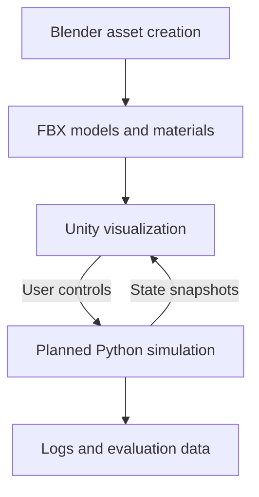

# SHIELD_AI

**An educational 3D simulation project combining Unity visualization, Blender assets, and a planned Python analysis backend.**

SHIELD_AI explores an abstract layered defense scenario using fictional or stylized objects. The project is currently in the **asset preparation stage**. The repository contains four 3D assets, previews, a project roadmap, and a Windows Blender MCP setup guide.

The models are nonfunctional exterior visuals. The project does not claim to reproduce or validate the performance of real defense systems.

## Current progress

| Area | Status |
|---|---|
| Radar asset | Created |
| FPV quadcopter asset | Created |
| Stylized delta-wing drone asset | Created |
| Generic missile exterior asset | Created |
| Local Blender MCP connection | Configured and tested in the author's local host |
| Unity integration | Planned |
| Python simulation and analysis | Planned |
| Machine learning experiments | Planned |

Asset creation reports describe successful FBX re-import checks. Unity integration still needs to be checked in the actual Unity project.

## 3D assets

| Asset | Triangles | Description |
|---|---:|---|
| Radar_01 | 1,856 | Base, rotating mount, and dish |
| FPV_Quadcopter_01 | 972 | Quadcopter with separate propellers |
| Shahed_Style_Drone_01 | 256 | Stylized delta-wing drone with rear propeller |
| Generic_Missile_01 | 420 | Fictional exterior model |
| **Total** | **3,504** | Four reusable assets |

See the [illustrated asset catalog](3D_assets/README.md) for previews, model downloads, dimensions, specifications, and import notes.

## Repository contents

| Path | Contents |
|---|---|
| [3D_assets/](3D_assets/) | Blender source files, FBX exports, previews, and available specifications |
| [SHIELD_AI_ROADMAP.md](SHIELD_AI_ROADMAP.md) | Project plan and proposed architecture |
| [Blender_MCP_Windows_Guide.md](Blender_MCP_Windows_Guide.md) | First-time local setup, restart checklist, and troubleshooting |

The roadmap describes intended work; its presence does not imply those features have been implemented.

## Tools

| Tool | Role |
|---|---|
| Blender | Model creation, materials, pivots, and FBX export |
| Unity | Planned scene visualization, animation, and interface |
| Python | Planned simulation, data processing, and analysis |
| MCP for Blender | Local tool connection for assisted Blender modeling |
| Git | Version control |

## Getting started with the assets

1. Open an asset's `.blend` file in Blender to inspect or edit its source.
2. Copy its `.fbx` file into the Unity project's `Assets/Models/` folder.
3. Place the imported model in a test scene.
4. Check scale, orientation, hierarchy, and material appearance.
5. Check the radar mount or propeller pivots before adding animation.
6. Create a Unity prefab after the import looks correct.

The reported export convention is **Unity +Z forward / +Y up**. Assets use simple gray and blue materials. Rendering-pipeline differences may require material adjustments in Unity.

## Planned software structure

This diagram is a proposed separation of responsibilities, not a description of a completed backend.

## Next milestones

- Import and check all four assets in Unity.
- Create reusable prefabs and a simple test scene.
- Demonstrate Python-to-Unity communication with a moving cube.
- Add logging, pause/restart controls, and reproducible replay.
- Expand the environment with reusable buildings and ground assets.

## Author

Muhammad Ahmad Khan

BS Computer Science, UET Peshawar — Nowshera Campus

## License

No license file was included in the supplied directory listing. Add an explicit license before setting reuse terms for the project or distributing its assets publicly.
